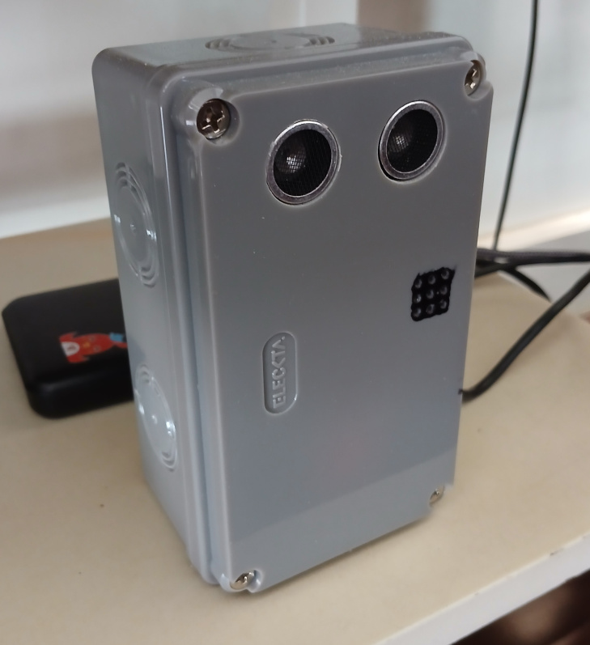

# Ultrasonic Bed Edge Motion Detector: Clinical Overview

For technical deployment, wiring diagrams, and source code setup, please refer to the [Technical README](./README_Ultrasonic-Proximity-Node.md).

---

---

## Executive Summary

The **Ultrasonic Bed Edge Motion Detector** is a non-blocking, network-connected monitoring system designed to provide an **early warning** for fall-risk patients. Unlike a weight sensor that trigger only when a patient fully leaves the bed, this system utilizes an ultrasonic distance sensor to establish a configurable containment zone, detecting when a patient moves toward the edge of a bed *before* an actual exit occurs.

---

## Key Clinical Features & Benefits

* **Proactive Pre-Exit Warning:** Focuses on edge motion detection to alert care staff prior to a full bed exit, maximizing response time to prevent falls.

* **Smart Caregiver-Quiet Lockout:** Prevents caregiver audio fatigue and clinical alarm fatigue. Once triggered, the local buzzer sounds for a brief duration and then turns off instantly, remaining silent even if the patient stays in the restricted zone.

* **Persistent Network State Latch:** The remote network status parameter locks at an active state (`2`) when motion is detected. It remains locked even if the patient moves back out of range, ensuring monitoring staff or supervisor scripts cannot miss the alert until it is explicitly acknowledged and cleared.

* **Transient Movement Filtering:** Incorporates an entry delay (default: 1000ms) requiring an object to remain continuously closer than the threshold distance, effectively filtering out harmless rolling or routine positional shifts.

---

## Operational Workflow & Clinical States

1. **Containment Zone Monitoring:**
* The system monitors the space using an ultrasonic distance sensor based on a user-defined boundary (`threshold`).

* Live distance readings can be checked dynamically to assist with physical placement and boundary setup.

2. **Detection & Alert Cascade:**
* When a patient breaches the threshold and the continuous entry delay is satisfied, the system initiates an immediate response.

* A local one-shot alarm sounds for the configured duration (`alarm_dur`, default: 1000ms) to notify anyone immediately present in the room.

* Simultaneously, an asynchronous push notification packet (`MOTION_EXIT_ALERT`) is instantly dispatched over the network to supervising stations (port 8888), and the network status flag latches to `2`.

3. **Clearance & Re-arming Hysteresis:**
* When the patient moves away from the edge (distance exceeding the threshold), a 2-second timeout window begins.

* If the area remains clear for the full duration, the device sounds a crisp 10ms click to signify successful re-arming and returns to a ready state.

* Care staff can clear the remote latched status via network commands (`status 0`), resetting the system for the next monitoring cycle.

---

## System Configuration & Customization

Care coordinators and facility administrators can adjust system parameters to match individual patient safety profiles:

* **Distance Boundary (`threshold`):** Configures the target distance boundary in centimeters to define the proximity warning zone.

* **Alarm Duration (`alarm_dur`):** Controls the duration of the local physical buzzer in milliseconds.

* **System State Latch (`status`):** Displays system readiness (`0`) or latched motion detection (`1`), and allows explicit resetting by clinical supervisor scripts.
